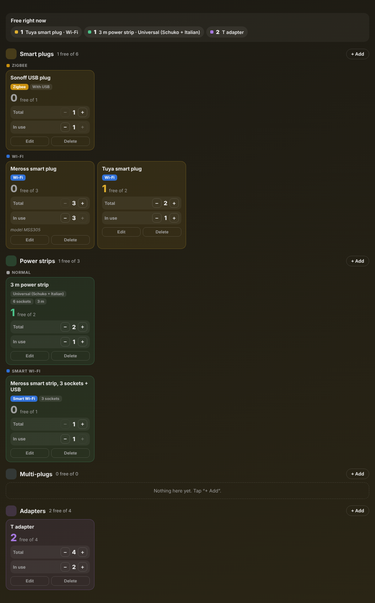

# Outlet Inventory Card

<p align="center">
  <a href="https://paypal.me/diesstech"></a>
  <a href="https://buymeacoffee.com/diesstech"></a>
  <a href="https://ko-fi.com/diesstech"></a>
</p>

A Home Assistant dashboard card to **count the power strips, smart plugs, multi-plugs and adapters you own** and see at a glance what is free.

> "OK, I have a 3 m power strip with 6 sockets free, a T adapter, and a Zigbee Schuko plug."



- Counts by **type**, not single devices: no names or entities needed, so it works for things you have just bought.
- **Free right now** bar at the top.
- **+ / −** buttons for *Total* (you bought one) and *In use* (you plugged one in).
- Smart plugs grouped by connection (**Zigbee / Wi-Fi / Matter**), strips with sockets, cable length and plug type.
- Add, edit and delete types right from the card.
- Follows your Home Assistant theme. Italian and English built in.
- **No custom integration**: the data is stored in normal **To-do lists** (e.g. *Local To-do*), so it is backed up with HA and readable by voice assistants.

## Installation

### HACS (custom repository)

[](https://my.home-assistant.io/redirect/hacs_repository/?owner=Diess-tech&repository=outlet-inventory-card&category=plugin)

Click the button above, or do it by hand:

1. HACS → ⋮ → *Custom repositories* → add `https://github.com/Diess-tech/outlet-inventory-card`, category **Dashboard**.
2. Install **Outlet Inventory Card**, then reload the browser.

### Manual
1. Copy `outlet-inventory-card.js` to `/config/www/`.
2. Settings → Dashboards → ⋮ → *Resources* → add `/local/outlet-inventory-card.js` as **JavaScript module**.

## Setup

1. Create one To-do list per category: Settings → Devices & services → *Add integration* → **Local To-do** (e.g. "Smart plugs", "Power strips", "Adapters").
2. Add the card:

```yaml
type: custom:outlet-inventory-card
title: Plugs & strips          # optional
show_free: true                # optional, default true
categories:
  - entity: todo.smart_plugs
    name: Smart plugs
    icon: mdi:lightning-bolt-circle
    color: "#e0b030"
    connections: [Zigbee, Wi-Fi, Matter / Thread]
    placeholder: e.g. Zigbee Schuko plug
  - entity: todo.power_strips
    name: Power strips
    icon: mdi:power-socket-eu
    color: "#4cc38a"
    connections: [Normal, Smart Wi-Fi, Smart Zigbee]
    sockets: true              # shows "Sockets" and "Cable length"
  - entity: todo.adapters
    name: Adapters
    icon: mdi:power-plug
    color: "#a678e0"
```

| Option | Description |
|---|---|
| `categories[].entity` | To-do list for that category (required) |
| `categories[].name` / `icon` / `color` | Title, MDI icon, accent color |
| `categories[].connections` | Choices for the *Connection* field; the category is grouped by it. Use `Normal`/`Normale` for non-smart items |
| `categories[].sockets` | `true` to show *Sockets* and *Cable length* |
| `categories[].placeholder` | Hint text in the description field |
| `plugs` | Your own list of plug types (default depends on language) |
| `language` | `it` or `en` (default: your HA language) |

## How the data is stored

Each To-do item is one **type**. Its description holds the counts:

```
Total: 2
In use: 1
Connection: Wi-Fi
Plug: Schuko (Type F)
Sockets: 6
Length: 3 m
```

Italian keys (`Totale`, `In uso`, `Collegamento`, `Attacco`, `Posti`, `Lunghezza`, `Note`) work too. An item is marked **completed** when nothing is free, so the list's state counts the types that still have free pieces — handy for automations or a badge.

---

## 🇮🇹 In breve

Card per Home Assistant che conta ciabatte, prese smart, multiprese e riduttori e mostra subito cosa è libero. I dati stanno in normali liste To-do (es. *Local To-do*), una per categoria: ogni voce è un **tipo** con *Totale* e *In uso* nella descrizione. Si installa come risorsa JavaScript (o da HACS come repository personalizzato) e si configura come nell'esempio sopra.

## License

MIT
